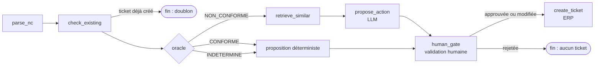

# ShopFloor Copilot

**Le problème.** En atelier, les fiches de non-conformité (NC) sont traitées à la main. Le savoir utile est dispersé entre les procédures et les anciennes NC.

**La solution.** Un copilote 100 % local vérifie la conformité, retrouve les cas similaires, propose une action corrective, puis crée le ticket ERP après validation humaine.

**Le gain attendu.** *Hypothèse à mesurer* : moins de temps passé par fiche et des actions plus homogènes d'un site à l'autre.

> **Toutes les données sont fictives. Aucun appel cloud.**

## Fonctionnement



## Ce qui rend le résultat fiable

- L'oracle déterministe est le seul juge. Il compare les mesures aux tolérances de `config/tolerances.yaml`.
- Le LLM ne décide jamais du verdict : son schéma de sortie n'a pas de champ verdict.
- Un garde-fou vérifie le texte proposé et ses sources.
- Une injection de prompt dans la fiche est testée : elle reste sans effet.
- Une validation humaine précède toute écriture dans l'ERP.
- Chaque ticket porte le `rules_hash` des tolérances appliquées.
- L'ERP refuse les doublons (un ticket par fiche).

## Exemple

Extrait de la sortie réelle pour NC-2026-101 ([sortie complète](docs/exemple_sortie_NC-2026-101.txt)) :

```text
Verdict de l'oracle : NON_CONFORME
  Caractéristique  Valeur  Min  Max  Écart  Statut
  porosite         2.8 %   -    2.0  0.8 %  NON_CONFORME

Documents similaires :
  NC-2025-014   score=0.883  (Description)
  PROC-COMP-01  score=0.792  (Contrôle final)

Proposition (origine : llm)
  Cause probable     : Fuite de la bâche à vide, comme sur la NC historique NC-2025-014, [...]
  Décision suggérée  : rebut
  Sources            : NC-2025-014, PROC-COMP-01

Ticket créé : TCK-0001
```

## Lancer en local

Prérequis : Windows ou Linux, Python 3.12, [Ollama](https://ollama.com) avec `qwen2.5:7b-instruct` et `nomic-embed-text`.

```bash
python -m venv .venv            # puis activer l'environnement
pip install -r requirements.lock
pip install -e . --no-deps
```

Les valeurs par défaut conviennent. Elles sont listées dans `.env.example` et se changent par variables d'environnement.

Puis trois commandes (le serveur ERP dans un terminal à part) :

```bash
python -m shopfloor.cli ingest
python -m uvicorn shopfloor.erp.api:app --port 8000
python -m shopfloor.cli process data/nc_inbox/NC-2026-101.md
```

Script de démo de 2 minutes : [docs/DEMO.md](docs/DEMO.md).

## Qualité

- 396 tests : 383 sans LLM (`pytest -m "not llm"`) et 13 avec le vrai Ollama (`pytest -m llm`).
- Bornes de l'oracle testées aux valeurs limites. Mutations manuelles des comparaisons (`>` en `>=`, `<` en `<=`, borne supprimée) : toutes détectées.
- Évaluation du retrieval : hit@3 = 5/5.

## Ce que ce projet démontre

- Outils internes à base de LLM.
- RAG sur des données internes.
- Agent simple pour une tâche opérationnelle.
- Intégration à une API de type ERP.
- Donnée structurée pour l'IA (tolérances en YAML, fiches à en-tête structuré).
- Passage d'un POC à un MVP.

## Limites connues

- Un modèle 7B peut se tromper sur un détail, par exemple un numéro d'opération mal attribué. La validation humaine est là pour ça.
- L'état de l'agent est en mémoire.
- Un seul cas d'usage pour l'instant.

## Roadmap

- Traitement automatique de la boîte de réception et file de validation.
- Interface et tableau de pilotage (taux d'acceptation, adoption par site).
- Assistant questions-réponses sur les procédures.
- API d'entrée et Docker compose.
- Cadre de lab IA et grille de priorisation ROI.
- OCR des fiches scannées.
- CI.
- Postgres.

## Méthode

Projet développé par étapes courtes, chacune taguée (v0.1 → v1.0), en pilotant un assistant de code IA (Claude Code) par briefs, revues de rapports et tests de non-régression.

C'est la logique de test & learn rapide que je propose pour un lab IA.

## Arborescence

```text
config/tolerances.yaml   tolérances, source unique de l'oracle
data/docs/               procédures, gammes et anciennes NC (fictives)
data/nc_inbox/           fiches NC à traiter
data/eval/               cas d'évaluation du retrieval
docs/                    cadrage, démo, exemple de sortie
src/shopfloor/
  oracle/                verdict déterministe
  rag/                   ingestion et recherche (ChromaDB)
  llm/                   client Ollama et prompts
  agent/                 graphe LangGraph, garde-fou, repli
  erp/                   fausse API ERP (FastAPI + SQLite) et client
  cli.py                 commandes ingest, search, process
tests/                   pytest, faux LLM déterministe
```

## Licence

MIT. Voir [LICENSE](LICENSE).
