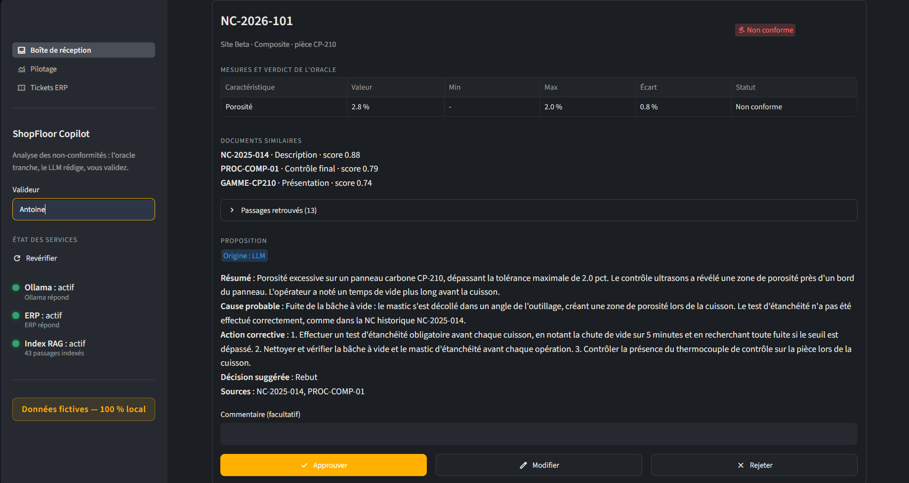
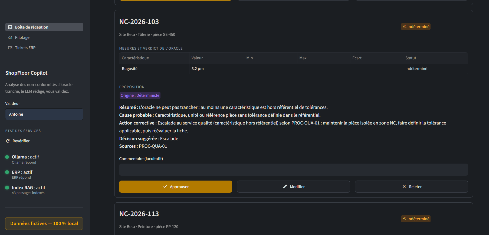
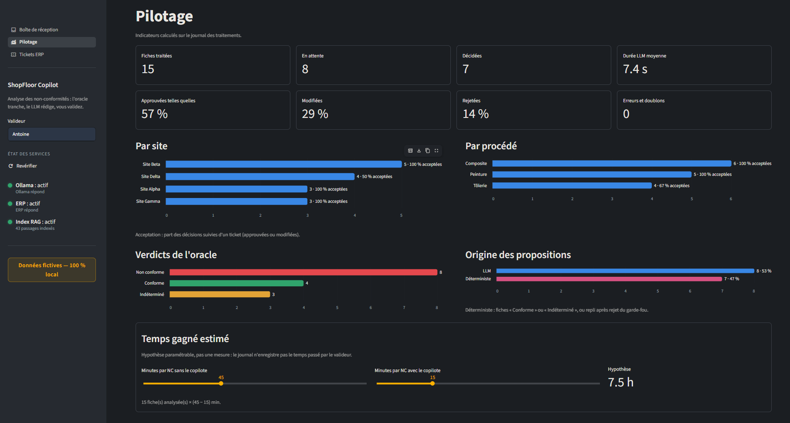
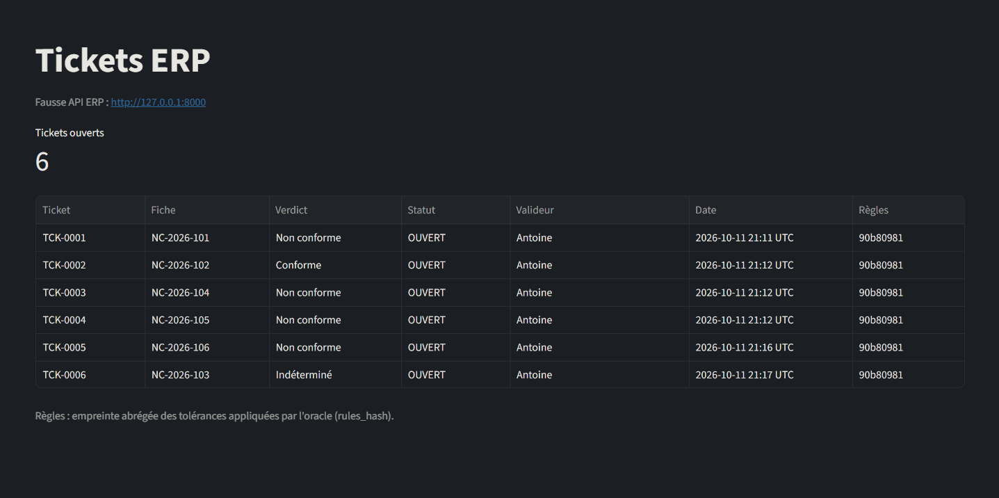

# ShopFloor Copilot

**Le problème.** En atelier, les fiches de non-conformité (NC) sont traitées à la main. Le savoir utile est dispersé entre les procédures et les anciennes NC.

**La solution.** Un copilote 100 % local vérifie la conformité, retrouve les cas similaires, propose une action corrective, puis crée le ticket ERP après validation humaine.

**Le gain attendu.** *Hypothèse à mesurer* : moins de temps passé par fiche et des actions plus homogènes d'un site à l'autre.

> **Toutes les données sont fictives. Aucun appel cloud.**



## Fonctionnement


## Ce qui rend le résultat fiable

- L'oracle déterministe est le seul juge. Il compare les mesures aux tolérances de `config/tolerances.yaml`.
- Le LLM ne décide jamais du verdict : son schéma de sortie n'a pas de champ verdict.
- Un garde-fou vérifie le texte proposé et ses sources.
- Une injection de prompt dans la fiche est testée : elle reste sans effet.
- Une validation humaine précède toute écriture dans l'ERP.
- Chaque ticket porte le `rules_hash` des tolérances appliquées.
- L'ERP refuse les doublons (un ticket par fiche).

## Interface

Une interface Streamlit pour le responsable qualité : boîte de réception, pilotage, tickets ERP.



Fiche sans tolérance de référence : l'oracle répond « Indéterminé » et la proposition est une escalade fixe, sans LLM.



Pilotage : volumes, part des propositions approuvées, modifiées ou rejetées, par site et par procédé. Le temps gagné y est une hypothèse paramétrable.



Tickets ERP : chaque ticket avec son verdict, son valideur et l'empreinte des tolérances appliquées.

Lancement (deux terminaux) :

```bash
python -m uvicorn shopfloor.erp.api:app --port 8000
python -m streamlit run src/shopfloor/ui/app.py
```

Puis ouvrir **http://127.0.0.1:8501** (pas `localhost` : l'interface n'écoute que sur 127.0.0.1).

Mode d'emploi : [docs/GUIDE_OPERATEUR.md](docs/GUIDE_OPERATEUR.md).

## Exemple

Extrait de la sortie réelle pour NC-2026-101 ([sortie complète](docs/exemple_sortie_NC-2026-101.txt)) :

```text
Verdict de l'oracle : Non conforme
  Caractéristique  Valeur  Min  Max  Écart  Statut
  Porosité         2.8 %   -    2.0  0.8 %  Non conforme

Documents similaires :
  NC-2025-014   score=0.883  (Description)
  PROC-COMP-01  score=0.792  (Contrôle final)

Proposition (origine : llm)
  Cause probable     : Fuite de la bâche à vide : le mastic s'est décollé dans un angle de l'outillage, [...]
  Décision suggérée  : rebut
  Sources            : NC-2025-014, PROC-COMP-01

Ticket créé : TCK-0001
```

## Lancer en local

Prérequis : Windows ou Linux, Python 3.12, [Ollama](https://ollama.com) avec `qwen2.5:7b-instruct` et `nomic-embed-text`.

```bash
python -m venv .venv            # puis activer l'environnement
pip install -r requirements.lock
pip install -e . --no-deps
```

Les valeurs par défaut conviennent. Elles sont listées dans `.env.example` et se changent par variables d'environnement.

Indexer les documents, puis lancer le serveur ERP dans un terminal à part :

```bash
python -m shopfloor.cli ingest
python -m uvicorn shopfloor.erp.api:app --port 8000
```

Une fiche, de bout en bout :

```bash
python -m shopfloor.cli process data/nc_inbox/NC-2026-101.md
```

Toute la boîte de réception, avec file de validation :

```bash
python -m shopfloor.cli run-inbox                     # analyse les nouvelles fiches
python -m shopfloor.cli pending                       # liste les fiches en attente
python -m shopfloor.cli decide NC-2026-101 approve --valide-par "Nom"
python -m shopfloor.cli decide NC-2026-103 edit --action "..." --valide-par "Nom"
python -m shopfloor.cli retry <nc_id>                 # remet une fiche en erreur dans le prochain run-inbox
```

Script de démo de 2 minutes : [docs/DEMO.md](docs/DEMO.md).

## Qualité

- 617 tests : 603 sans LLM (`pytest -m "not llm"`) et 14 avec le vrai Ollama (`pytest -m llm`).
- Bornes de l'oracle testées aux valeurs limites. Mutations manuelles des comparaisons (`>` en `>=`, `<` en `<=`, borne supprimée) : toutes détectées.
- Évaluation du retrieval : hit@3 = 5/5.

## Ce que ce projet démontre

- **Outils IA** : copilote métier, automatisation d'une boîte de réception, RAG sur des documents internes, agent avec validation humaine.
- **Lab IA et test & learn** : étapes courtes et taguées, mesure d'adoption dans le Pilotage, cadre de lab ([docs/LAB_IA.md](docs/LAB_IA.md)), backlog priorisé par une grille ROI ([docs/USE_CASES.md](docs/USE_CASES.md)).
- **Intégration** : API de type ERP, donnée structurée pour l'IA (tolérances en YAML, fiches à en-tête structuré), traçabilité des règles appliquées.
- **Déploiement terrain** : interface pour le responsable qualité, voyants d'état, guide et plan de formation ([docs/GUIDE_OPERATEUR.md](docs/GUIDE_OPERATEUR.md)).

## Limites connues

- Un modèle 7B peut se tromper sur un détail, par exemple un numéro d'opération mal attribué ou une consigne prise dans un document non cité. La validation humaine est là pour ça.
- Le temps gagné n'est pas mesuré : le journal n'enregistre pas le temps passé par le valideur.
- Un seul cas d'usage pour l'instant, sans authentification.

## Roadmap

- CI (GitHub Actions).
- Images Docker publiées par CD.
- Assistant questions-réponses sur les procédures.
- API d'entrée des fiches.
- OCR des fiches scannées.
- Postgres.
- Authentification.
- Déploiement sur serveur on-premise avec GPU.

## Méthode

Projet développé par étapes courtes, chacune taguée (v0.1 → v1.2), en pilotant un assistant de code IA (Claude Code) par briefs, revues de rapports et tests de non-régression.

C'est la logique de test & learn rapide que je propose pour un lab IA : voir [docs/LAB_IA.md](docs/LAB_IA.md).

## Arborescence

```text
config/tolerances.yaml   tolérances, source unique de l'oracle
data/docs/               procédures, gammes et anciennes NC (fictives)
data/nc_inbox/           fiches NC à traiter
data/eval/               cas d'évaluation
docs/                    cadrage, lab IA, cas d'usage, guide opérateur, démo, captures
src/shopfloor/
  oracle/                verdict déterministe
  rag/                   ingestion et recherche (ChromaDB)
  llm/                   client Ollama et prompts
  agent/                 graphe LangGraph, garde-fou, repli
  erp/                   fausse API ERP (FastAPI + SQLite) et client
  ui/                    interface Streamlit
  service.py             boîte de réception et file de validation
  journal.py, kpis.py    journal des traitements et indicateurs du Pilotage
  cli.py                 commandes ingest, search, process, run-inbox, pending, decide, retry
tests/                   pytest, faux LLM déterministe
```

## Licence

MIT. Voir [LICENSE](LICENSE).
